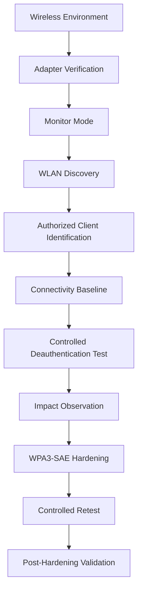
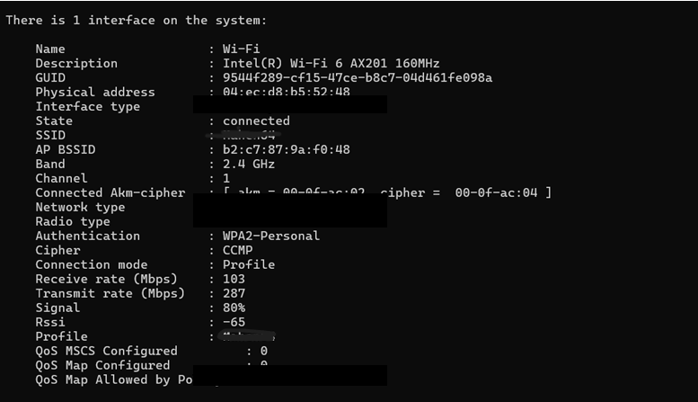
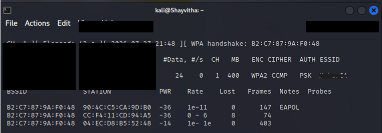
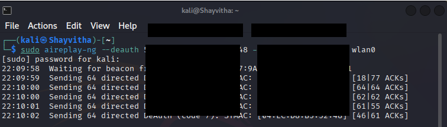
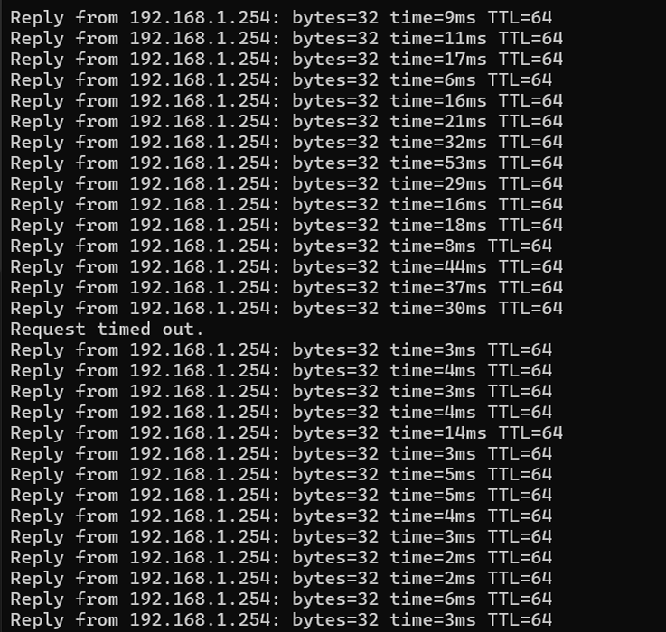
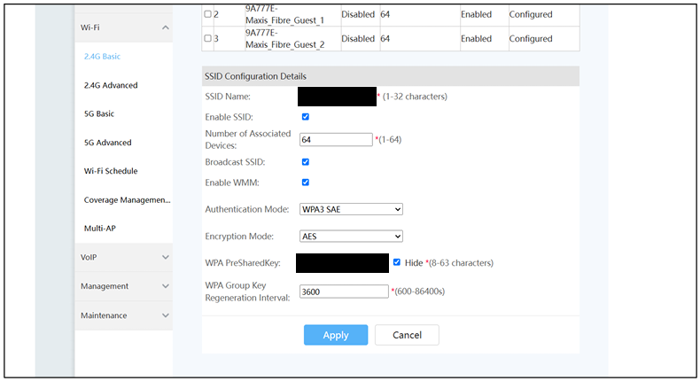
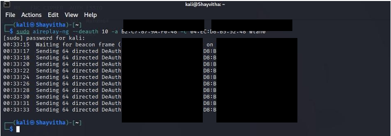
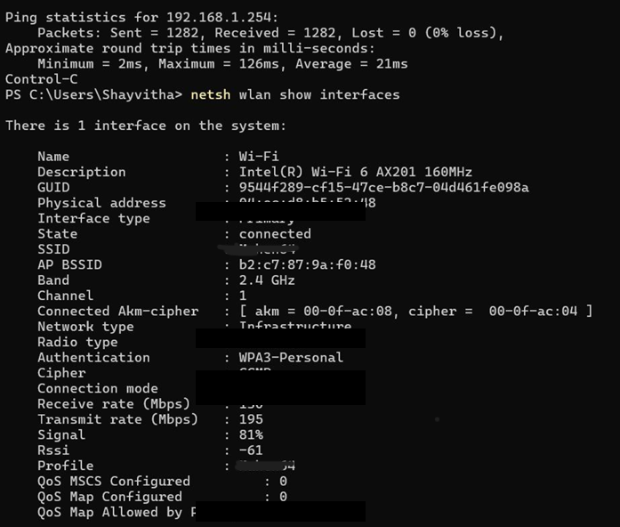

# WLAN Deauthentication Security Assessment

A controlled wireless security assessment examining IEEE 802.11 deauthentication behavior, client connectivity impact, and defensive wireless hardening within an authorized home-lab environment.

Kali Linux • VMware • Aircrack-ng • Airodump-ng • Aireplay-ng • IEEE 802.11 • WPA2 • WPA3-SAE

## Project Overview

**Problem:** Wireless deauthentication can affect client availability by utilizing forged management frames to disconnect clients from a network.
**Assessment:** Controlled testing against an authorized WLAN and client device.
**Evidence:** The assessment progressed from monitor mode verification, through WLAN observation and baselining, to a controlled test demonstrating connectivity impact.
**Hardening:** The wireless security configuration was moved from a documented WPA2 baseline to WPA3-SAE.
**Validation:** Controlled retesting was performed.
**Result:** No observable connectivity disruption was recorded in the captured post-hardening test window.
**Limitations:** Do not generalize the result beyond the tested environment.

## Assessment Workflow

## Security Baseline
The initial configuration was established as a WPA2-Personal (CCMP/PSK) baseline. The client device was confirmed to be associated under these conditions.

**Client WPA2 Association:**

## WLAN Discovery & Scope Control
Passive WLAN discovery identified the authorized target network and isolated the specific authorized client device for testing. 

**Authorized Client Identification:**

## Controlled Deauthentication Assessment
A controlled deauthentication test was executed targeting the specific authorized client device to assess the network's resilience.

## Observed Connectivity Impact
During the controlled test, the immediate impact on the client device's network connectivity was actively monitored via continuous ICMP ping requests to the local gateway. 

**Connectivity Disruption:**

## Wireless Security Hardening
The router's wireless security configuration was upgraded to WPA3-SAE. 

**WPA3-SAE Router Configuration:**

Protected Management Frames are directly relevant to deauthentication/disassociation resilience. However, the available portfolio evidence does not independently establish the PMF configuration used during this assessment.

## Post-Hardening Validation
A final controlled retest was performed to validate the effectiveness of WPA3-SAE. 

**Controlled WPA3 Retest:**

**Post-Hardening Result:**
No observable connectivity disruption was recorded during the documented test window. This is an observational result specific to this router, client, configuration, and lab environment.

## Documentation
Detailed documentation of the procedures and findings is available in the `docs/` directory:
- [Methodology](docs/methodology.md)
- [Test Plan](docs/test-plan.md)
- [Findings](docs/findings.md)
- [Countermeasures](docs/countermeasures.md)

## Skills Demonstrated
- Wireless interface configuration
- Passive WLAN discovery
- Controlled deauthentication testing (Aircrack-ng suite)
- Network connectivity impact analysis
- Defensive wireless security hardening

## Ethical Scope
This assessment was performed strictly within a controlled home-lab environment against a personally owned WLAN and authorized client. Neighboring networks were not intentionally targeted. Screenshots have been sanitized before publication for defensive and educational portfolio purposes.
