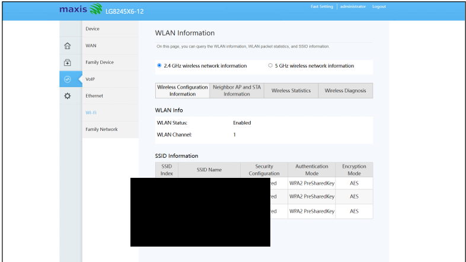
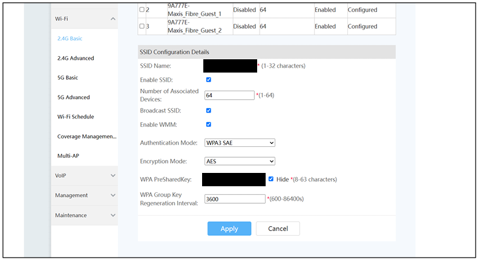
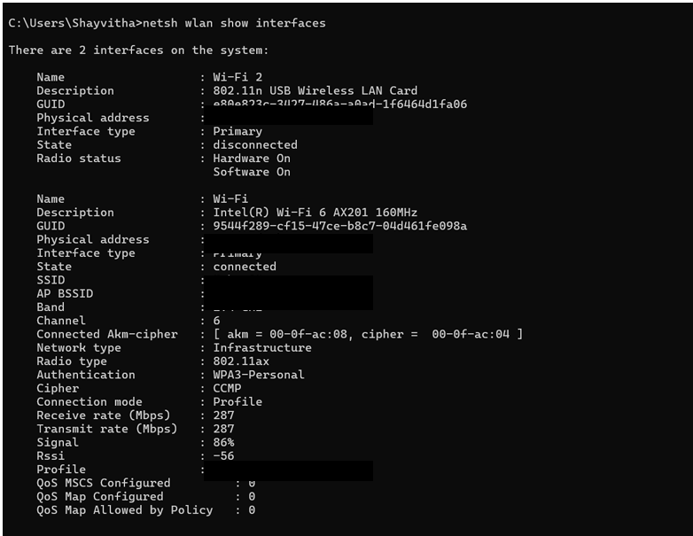
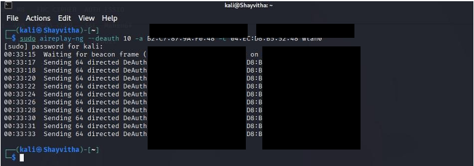
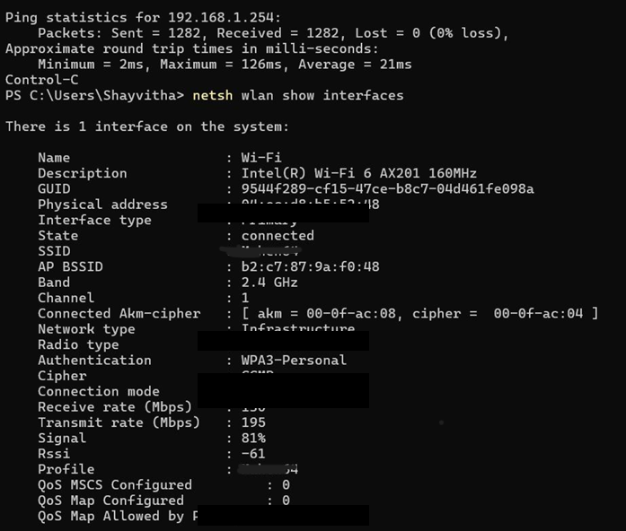

# Countermeasures

This document describes the security hardening steps taken, particularly the implementation of WPA3-SAE.

## WPA2 Baseline Observation

The initial test environment utilized WPA2-Personal, which lacked built-in protection for management frames.

**WPA2 Router Baseline:**

## Implementing WPA3-SAE

To address the observed disruption, the router's wireless security configuration was migrated to WPA3-SAE (Simultaneous Authentication of Equals). 

**WPA3-SAE Router Configuration:**

Protected Management Frames (PMF / IEEE 802.11w) are directly relevant to deauthentication/disassociation resilience. However, the available portfolio evidence does not independently establish the precise PMF configuration used during this assessment (e.g., whether it was set to Optional or Required), though it is generally mandated by the WPA3 standard.

**WPA3 Client Reconnection Validation:**
The client successfully connected using the new configuration.

## Retesting and Validation

Following the configuration change, the controlled deauthentication test was repeated.

**Controlled WPA3 Retest:**

**Post-Hardening Result:**
During this specific retest, the client maintained connectivity without observable disruption.

