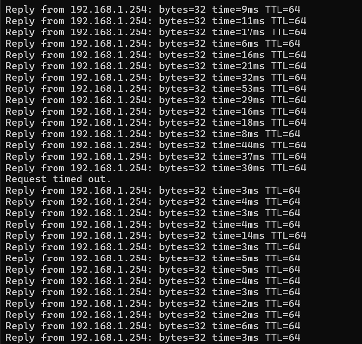
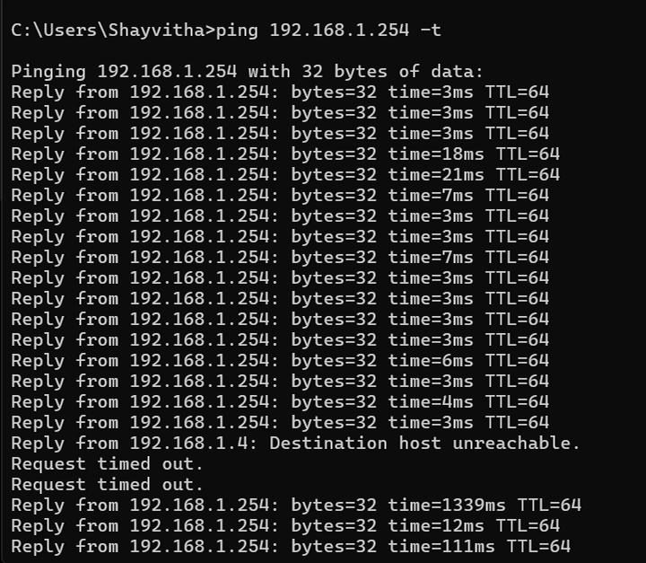
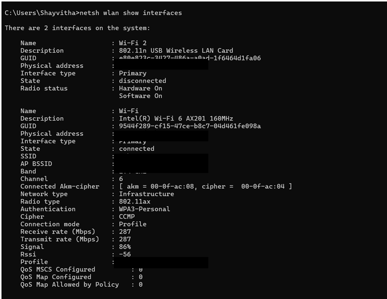
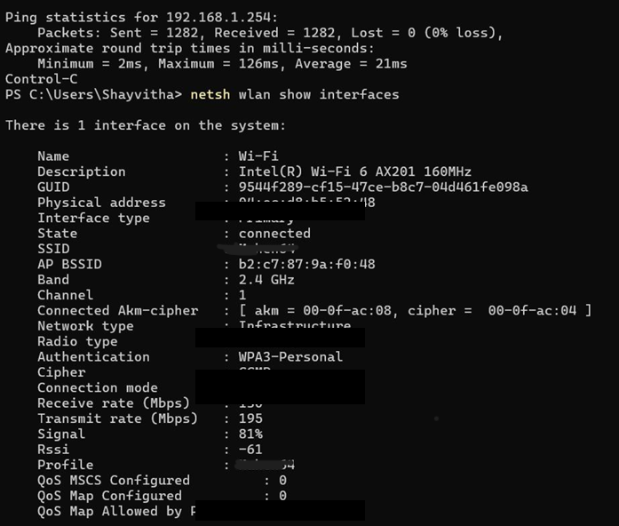

# Key Findings

This document summarizes the observable results of the deauthentication assessment and the effectiveness of defensive measures.

The controlled assessment examined IEEE 802.11 deauthentication behavior and its observable effect on an authorized client's connectivity.

## Connectivity Disruption

During the initial phase of the test against the WPA2-Personal baseline, significant connectivity disruption was observed on the targeted client device.

**Connectivity Disruption:**

A subsequent repeat test demonstrated severe disruption, successfully halting the client's network communication during the test window.

**Repeat Test Impact:**

## Post-Hardening Validation

After transitioning the router's configuration to WPA3-SAE, the client successfully re-associated using the new parameters.

**WPA3 Client Reconnection Validation:**

After wireless configuration hardening and retesting, no observable connectivity disruption was recorded during the documented test window. 

**Post-Hardening Result:**

*Note: This is an observational result specific to this router, client, configuration, and lab environment. It does not imply that WPA3-SAE universally prevents deauthentication attacks against all possible vectors.*
