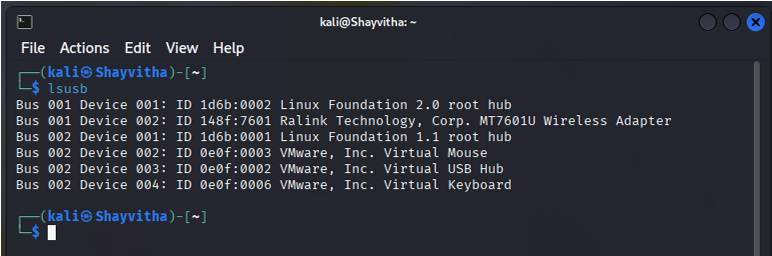
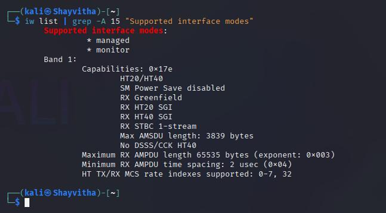
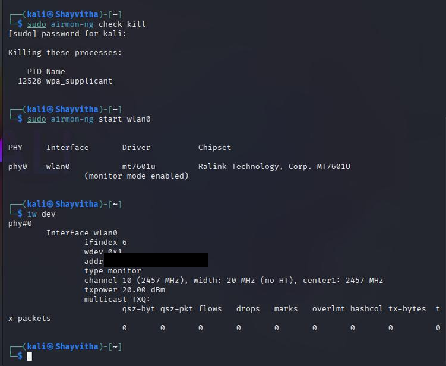
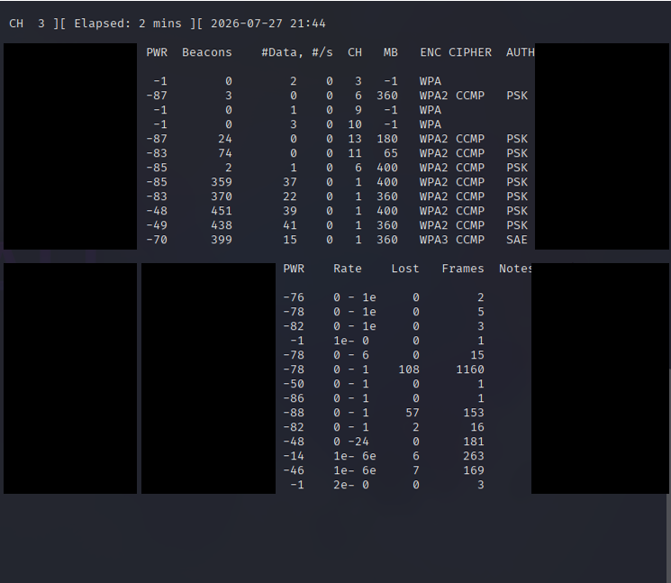
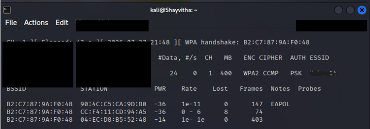

# Methodology

This document details the systematic approach and procedures followed during the wireless security assessment, focusing on environment setup, capability verification, and passive target discovery.

## Environment and Adapter Verification

The assessment was conducted using a Kali Linux virtual machine. To interact with 802.11 frames, a dedicated wireless adapter was utilized. The Ralink MT7601U USB wireless adapter was attached and detected by the host system.

**USB Adapter Detection:**

Before proceeding, it was necessary to confirm the hardware capabilities of the adapter, specifically its support for monitor mode and packet injection. 

**Supported Interface Modes Verification:**

Upon verification, the adapter's interface was placed into monitor mode using `airmon-ng`.

**Monitor Mode Enabled:**

## WLAN Discovery and Scope Control

Passive WLAN discovery was conducted to identify the authorized target network in the air and isolate the specific authorized client device for testing. All testing was strictly limited to this identified device on the researcher's own WLAN. Neighboring networks were not intentionally targeted.

**Passive WLAN Discovery:**

**Authorized Client Identification:**

