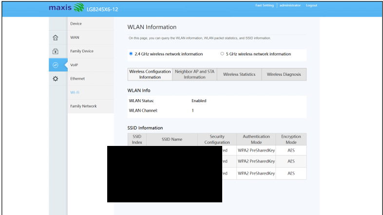
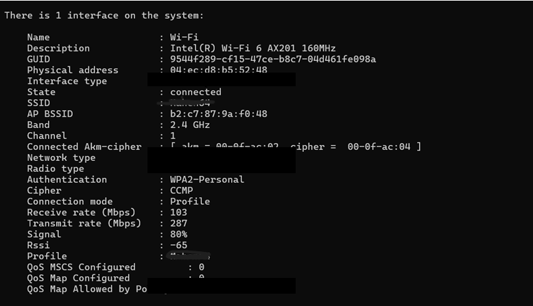
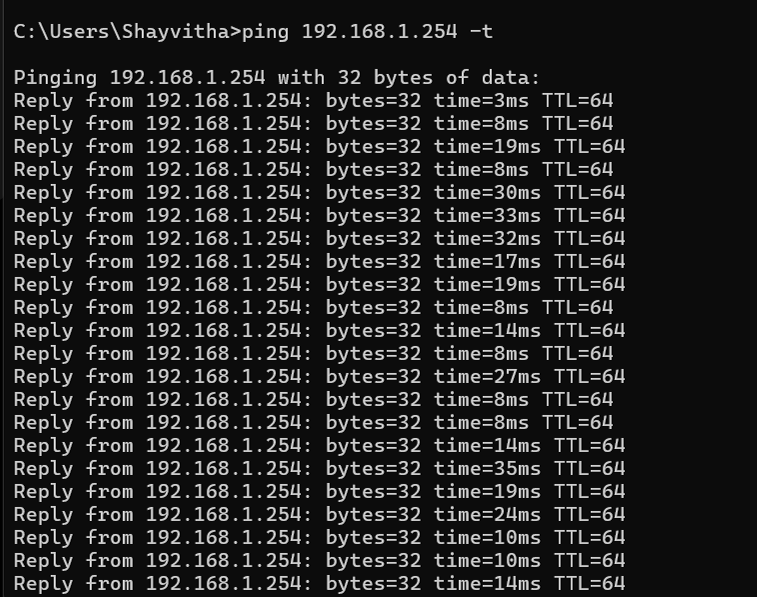
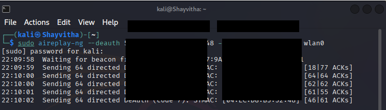

# Test Plan

This document outlines the testing stages, tools utilized, and the established baselines before executing the controlled deauthentication test.

## Security Baseline Configuration

The initial configuration of the authorized home network was established as a WPA2-Personal (CCMP/PSK) baseline, representing a standard residential wireless security posture prior to testing.

**Router WPA2 Configuration:**

**Client WPA2 Association:**
The target client device was verified to be connected using this configuration.

## Connectivity Baseline

Before initiating any testing, normal connectivity between the target client and the local gateway was verified to establish a behavioral baseline.

**Baseline Connectivity (Pre-Test):**

## Execution of Controlled Test

With the environment established and baseline connectivity verified, the test plan involves executing a controlled deauthentication test using the `aireplay-ng` tool against the authorized client device to observe the impact on its connection.

**Executing the Attack:**

